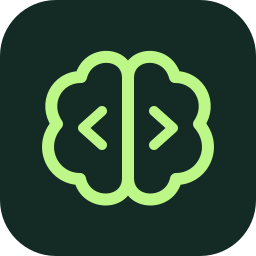

# VibeWise for Google Antigravity

**You build. AI writes.**

A plugin for **Google Antigravity** (Antigravity IDE, Antigravity 2.0, and the `agy` CLI) that puts engineering learning first and keeps you in control while AI writes the code you designed.

Instead of generating an entire feature while you watch passively, Antigravity **asks for your approach first**, helps you examine tradeoffs, and explains unfamiliar concepts. You shape the architecture and decide when a step is ready to implement. Antigravity writes the agreed code, runs verification checks, and walks you through both **what** was built and **how** the code actually works—with real file excerpts, line-by-line syntax explanations, and concrete traces.

Built for anyone who wants to learn as they build—whether you're an aspiring software engineer, a junior developer, or an experienced engineer exploring an unfamiliar codebase or stack.

---

## Table of Contents

- [How It Works in Antigravity](#how-it-works-in-antigravity)
- [Installation](#installation)
  - [Option 1: Global Plugin (Recommended)](#option-1-global-plugin-recommended)
  - [Option 2: Workspace Plugin (Per-Project)](#option-2-workspace-plugin-per-project)
  - [Option 3: External Path via `plugins.json`](#option-3-external-path-via-pluginsjson)
- [How to Use VibeWise](#how-to-use-vibewise)
  - [1. Start or Resume Learning Mode](#1-start-or-resume-learning-mode)
  - [2. Interactive Onboarding](#2-interactive-onboarding)
  - [3. Build Through Checkpoints](#3-build-through-checkpoints)
  - [4. Reset Project Learning Notes](#4-reset-project-learning-notes)
- [What It Feels Like (Walkthrough)](#what-it-feels-like-walkthrough)
- [Checkpoints & Callouts Reference](#checkpoints--callouts-reference)
- [Make It Yours](#make-it-yours)
- [Local `.vibe-wise/` State & Privacy](#local-vibe-wise-state--privacy)
- [Plugin Structure](#plugin-structure)
- [Development & Testing](#development--testing)
- [Credits & License](#credits--license)

---

## How It Works in Antigravity

VibeWise is packaged as a native Google Antigravity customization bundle:

1. **On-Demand Skills (`skills/learn` & `skills/reset`)**:
   - **`learn`**: Runs interactive onboarding using Antigravity's native `ask_question` modal, maps existing repositories, and enforces the learner-led **Build → Design → Implementation → Report & Code Walkthrough** loop.
   - **`reset`**: Previews and safely backs up `.vibe-wise/` learning notes into `.vibe-wise/backups/` using a cryptographic snapshot token before restarting onboarding.
2. **Automatic Session & Turn Restoration (`hooks.json` → `hooks/session_start.py`)**:
   - Registers a lightweight, read-only **`PreInvocation`** hook. When your project has an active `.vibe-wise/profile.md`, the hook injects a transient `ephemeralMessage` on the first model call of a turn (`invocationNum == 1`) instructing Antigravity to load `skills/learn/SKILL.md` and restore your profile, project map, and any pending checkpoint decisions—even across restarts or `/compact`.
   - Installing the plugin does **not** force learning mode onto every project automatically. Projects without `.vibe-wise/` (or with `Learning mode: paused`) remain completely unaffected.
3. **Command Routing Rules (`rules/AGENTS.md`)**:
   - Routes `/vibe-wise:learn` (`vibe-wise learn`) and `/vibe-wise:reset` (`vibe-wise reset`) directly to the VibeWise skills so they never collide with Antigravity's built-in `/learn` slash command.

---

## Installation

You need **Google Antigravity** (2.0 App, IDE, or `agy` CLI) and **Python 3.8+** (`python` on `PATH`). No third-party Python packages are required.

### Option 1: Global Plugin (Recommended)

Install VibeWise into your global Antigravity plugins directory so it is available across all of your projects:

**macOS / Linux:**

```sh
git clone https://github.com/vijayamukesh13j/vibe-wise.git ~/.gemini/config/plugins/vibe-wise
```

**Windows (PowerShell):**

```powershell
git clone https://github.com/vijayamukesh13j/vibe-wise.git "$HOME\.gemini\config\plugins\vibe-wise"
```

Restart Antigravity after cloning so the new plugin directory is discovered. You can toggle VibeWise on or off anytime from **Skills & Customizations → Plugins**.

### Option 2: Workspace Plugin (Per-Project)

To bundle VibeWise inside a specific repository so everyone on your team gets it automatically:

```sh
git clone https://github.com/vijayamukesh13j/vibe-wise.git .agents/plugins/vibe-wise
```

### Option 3: External Path via `plugins.json`

If you keep a single local clone of `vibe-wise` elsewhere on disk (for example `e:/Plugins/vibe-wise` or `~/plugins/vibe-wise`), register its parent folder in `.agents/plugins.json` (workspace) or `~/.gemini/config/plugins.json` (global):

```json
{
  "entries": [
    {
      "path": "~/plugins",
      "include_only": ["vibe-wise"]
    }
  ]
}
```

---

## How to Use VibeWise

### 1. Start or Resume Learning Mode

Open your project in Antigravity and send any of the following prompts in chat (or click the starter prompt on the VibeWise plugin card):

```text
/vibe-wise:learn
```

*(You can also type `vibe-wise learn` or `Activate VibeWise learning mode for this project`.)*

> [!NOTE]
> Use `/vibe-wise:learn` (or `vibe-wise learn`) rather than `/learn` alone—in Antigravity, `/learn` is a built-in slash command for saving general agent memories.

### 2. Interactive Onboarding

On first run in a project, VibeWise guides you through setup **one question at a time** using Antigravity's interactive `ask_question` modal:

1. **Project situation**: *New project*, *Existing repo*, or *Known project*.
   - For an **Existing repo**, Antigravity first inspects entry points, dependencies, storage, and config to sketch an evidence-based system map in `.vibe-wise/project-map.md`, then asks about your codebase familiarity and desired learning scope.
2. **Experience & Stack familiarity**: *Beginner*, *Intermediate*, or *Advanced*.
3. **Preferences**:
   - Pick **Use defaults** (*Normal* checkpoints, *Open-ended* reasoning questions, *AI writes code*) to finish setup immediately.
   - Or pick **Customize** to configure checkpoint frequency (*Light / Normal / Frequent*), question style (*Open-ended / Multiple choice / Mixed*), and coding style (*AI writes / A mix / More hands-on*).

### 3. Build Through Checkpoints

Once onboarding completes, ask Antigravity to build or change anything in your project:

- Antigravity pauses at meaningful engineering decisions with a **`✦ Build checkpoint`** and asks how you want to approach the problem in plain English.
- If a concept is unfamiliar, ask for an explanation or say *"I'm stuck"*—Antigravity explains the concept (`✦ Concept` and `✦ Why this matters`) and returns the design choice to you.
- When a design takes shape, Antigravity presents a **`✦ Design checkpoint`** or **`✦ Implementation checkpoint`** and opens an interactive confirmation picker (**Confirm and continue** / **Implement this step** vs **Discuss**).
- Only after you select **Implement this step** does Antigravity write the code, run tests, and present a concise **`✦ Implementation report`**.
- Whenever a topic's code already exists in the repo or has just been written, Antigravity follows up with a **`✦ Code walkthrough`** (`Code walkthroughs: Always` by default): quoting real 5–25 line excerpts with clickable file/line links, explaining unfamiliar syntax or framework APIs line by line, and tracing one concrete input through the code step by step.

### 4. Reset Project Learning Notes

To archive your current learning notes and restart onboarding for the current project from scratch:

```text
/vibe-wise:reset
```

1. Antigravity runs a read-only preview (`skills/reset/reset.py --cwd "<project>"`) and shows the project path, `.vibe-wise/` state directory, and files that will be reset.
2. It asks for confirmation (**Cancel** vs **Reset learning**).
3. If confirmed, it backs up `profile.md`, `progress.md`, and `project-map.md` into a timestamped folder inside `.vibe-wise/backups/reset-<timestamp>/` and begins fresh onboarding. Your source code and Git history are never touched.

---

## What It Feels Like (Walkthrough)

Suppose you are building a Notion-style notes app where users organize private notes into folders, and you're deciding what happens when someone deletes a folder.

**You:**

```text
A note can be in several folders. Deleting a folder should delete its notes.
```

**Antigravity:**

```text
✦ Build checkpoint: Deleting a shared note

"Trip ideas" is in both Travel and Summer. Deleting it removes it from both.

When someone deletes Travel, what should happen to that note in Summer?
```

**You:**

```text
Keep it in Summer. If it has no folders left, keep the note outside any folder.
```

**Antigravity:**

```text
That separates deleting a folder from deleting a note.

---

✦ Build checkpoint: Connecting notes and folders

How would you represent which folders a note belongs to, without copying the note?
```

**You:**

```text
A links table with note_id and folder_id. Deleting a folder removes its links,
not the notes.
```

**Antigravity:**

```text
Each link records one membership. Several links can point to the same note;
a note with no links is unfiled.

notes ← folder links → folders

---

✦ Design checkpoint: Folder membership

Proposed: store notes once and track folder membership in a links table.
Deleting a folder removes its links and keeps the notes. This supports multiple
folders per note; loading a folder's notes needs a lookup through those links.

Confirming records this design. We still need to work through access rules
and technology choices before writing code.
```

*(Antigravity opens the interactive `ask_question` modal:)*
- **1. Confirm and continue — This approach makes sense to me; move to the next piece.**
- **2. Discuss — Ask questions or clarify anything that doesn't make sense before deciding.**

Later, once the step's decisions are ready to code:

**Antigravity:**

```text
✦ Implementation checkpoint: Folder membership

I'll add the agreed tables and folder-deletion operation, then test that deleting
a folder preserves its notes and their membership in other folders.
This step builds storage behavior; the UI comes later.
```

- **1. Implement this step — This approach makes sense to me; write the code for this step.**
- **2. Discuss — Ask questions or clarify anything that doesn't make sense before deciding.**

After you choose **Implement this step**, Antigravity writes the code, runs the tests, and reports back:

```text
✦ Implementation report: Folder membership

- Added the schema migration: each membership references one note and one folder.
- Added folder deletion: removes the folder and its links, preserving note content.
- Added and ran tests for shared notes and notes left without a folder; both passed.
```

---

## Checkpoints & Callouts Reference

| Heading | Purpose |
| :--- | :--- |
| `✦ Build checkpoint: <topic>` | Invites you to reason through how to approach a problem in your own words. |
| `✦ Design checkpoint: <topic>` | Summarizes the proposed design and tradeoffs. **Confirm and continue** records the design without writing code yet. |
| `✦ Implementation checkpoint: <topic>` | Describes the exact code changes ready to be made. **Implement this step** authorizes Antigravity to write the code. |
| `✦ Implementation report: <topic>` | Explains what changed, how the key code works, how it fits your design, and test verification results. |
| `✦ Code walkthrough: <topic>` | Shows *how* the code is built: file map, small real code excerpts with line links, plain-language syntax/API breakdown, and a concrete step-by-step trace. |
| `✦ System check: <topic>` | Connects how components fit together at key milestones. |
| `✦ Concept: <topic>` | Explains what an unfamiliar concept is or how it works (no mandatory quiz). |
| `✦ Why this matters: <topic>` | Explains the practical relevance or consequences of a concept in your project. |

When Antigravity proposes additional implementation details beyond what you specified, it separates them into a compact **Proposed additions** table (`Detail | Proposal | Why it matters`) so you can question or change any item before approving.

---

## Make It Yours

Experience level changes the teaching support you receive, never your ownership of decisions:

| Level | Teaching Approach |
| :--- | :--- |
| **Beginner** | Explains unfamiliar pieces, uses compact diagrams, asks smaller reasoning questions. |
| **Intermediate** | Less introductory context; focuses on component interactions and tradeoffs. |
| **Advanced** | Probes difficult constraints, failure modes, trust boundaries, and design assumptions. |

You can adjust VibeWise anytime in plain English without resetting:

- *"Use fewer checkpoints"* / *"Set checkpoint frequency to Light"*
- *"Only show code walkthroughs when I ask"* (switches `Code walkthroughs` from `Always` to `On request`)
- *"Focus on backend architecture"*
- *"Use multiple-choice questions"*
- *"Just implement this one"* (skips the checkpoint loop for the current request)
- *"Pause learning"* (sets `Learning mode: paused` in `.vibe-wise/profile.md`; resume anytime with `/vibe-wise:learn`)

---

## Local `.vibe-wise/` State & Privacy

All learning state lives locally in `.vibe-wise/` at your project's Git root (or current working directory if not using Git):

- `.vibe-wise/profile.md` — Your current preferences, experience level, and demonstrated vs developing concepts.
- `.vibe-wise/progress.md` — Concise topic logs (`Introduced`, `Demonstrated understanding`, `Needs reinforcement`) and any `## Pending decision`.
- `.vibe-wise/project-map.md` — Evidence-based component map, main data flow, trust boundaries, and open unknowns.
- `.vibe-wise/backups/` — Timestamped snapshots created when you run `/vibe-wise:reset`.

Add `.vibe-wise/` to your project's `.gitignore` to keep your personal learning notes out of version control (VibeWise will never edit your `.gitignore` silently). There is no external backend, account, or telemetry.

---

## Plugin Structure

```text
vibe-wise/
├── plugin.json                  # Antigravity plugin manifest
├── hooks.json                   # Antigravity PreInvocation lifecycle hook config
├── README.md                    # Documentation and usage guide
├── LICENSE                      # MIT License
├── assets/
│   ├── logo.svg                 # Plugin icon (SVG)
│   └── vibewise-icon.png        # Plugin icon (PNG)
├── hooks/
│   ├── session_start.py         # Read-only context restoration hook (Antigravity & Claude Code)
│   └── hooks.json               # Legacy SessionStart hook config
├── rules/
│   └── AGENTS.md                # Command routing (/vibe-wise:learn, /vibe-wise:reset) & activation boundary
├── skills/
│   ├── learn/
│   │   ├── SKILL.md             # Main learn skill entrypoint
│   │   ├── antigravity.md       # Antigravity tool mappings (view_file, ask_question, etc.)
│   │   ├── behavior.md          # Core learning loop, checkpoints, and evidence rules
│   │   ├── code-walkthrough.md  # "How it's built" code walkthrough guide (excerpts, syntax, traces)
│   │   ├── onboarding.md        # Step-by-step onboarding flow
│   │   ├── state-templates.md   # Templates for profile.md, progress.md, project-map.md
│   │   └── codex.md             # Multi-agent compatibility notes
│   └── reset/
│       ├── SKILL.md             # Main reset skill entrypoint
│       ├── antigravity.md       # Antigravity reset conventions
│       ├── reset.py             # Snapshot-verified backup and reset helper
│       └── codex.md             # Multi-agent compatibility notes
├── docs/
│   ├── development.md           # Developer and verification guide
│   └── demos/
│       └── notion-dupe.md       # Example walkthrough transcript
└── tests/
    ├── test_session_start.py    # 29 tests for Antigravity PreInvocation & SessionStart hooks
    └── test_reset.py            # 15 tests for preview, token confirmation, backups, and symlinks
```

---

## Development & Testing

Run the automated test suite with Python's standard `unittest` runner (zero external dependencies):

```sh
python -B -m unittest discover -s tests -v
```

See [docs/development.md](docs/development.md) for full details on hook verification and manual conversation smoke tests.

---

## Credits & License

Adapted for **Google Antigravity** from [nykooi1/vibe-wise](https://github.com/nykooi1/vibe-wise) by Noah Kim.

Released under the [MIT License](LICENSE).
